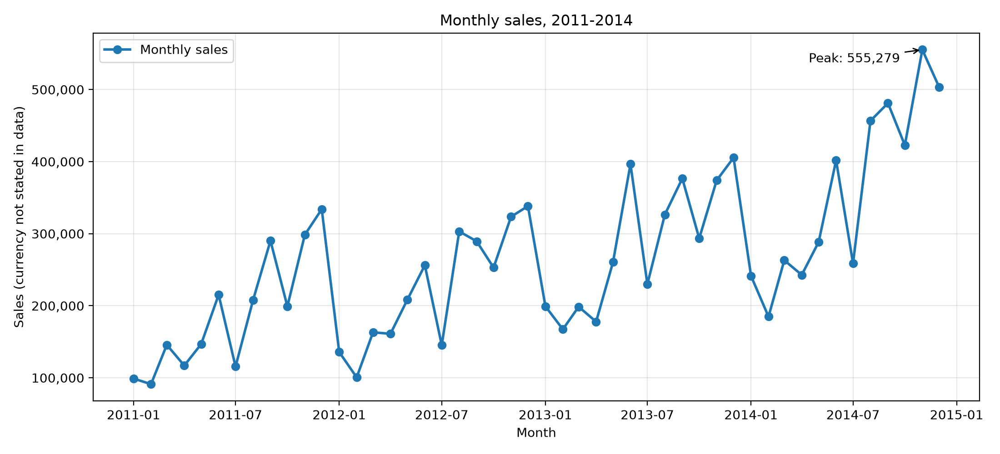
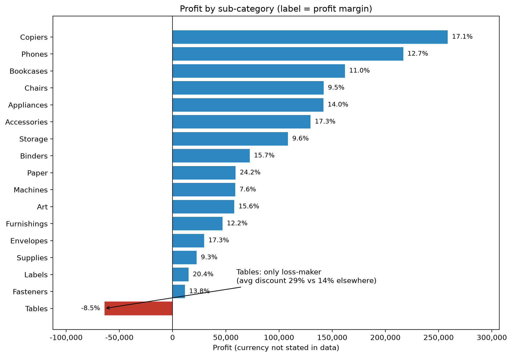
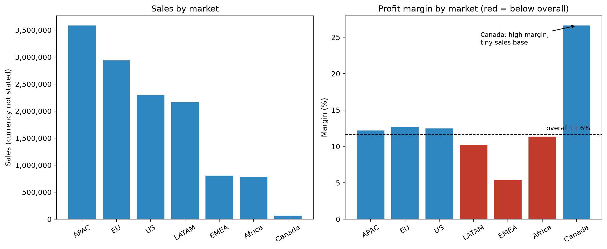
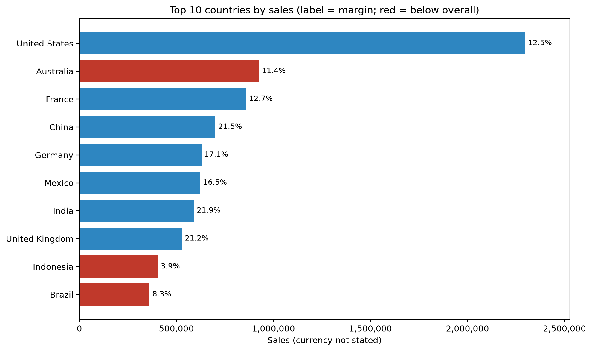
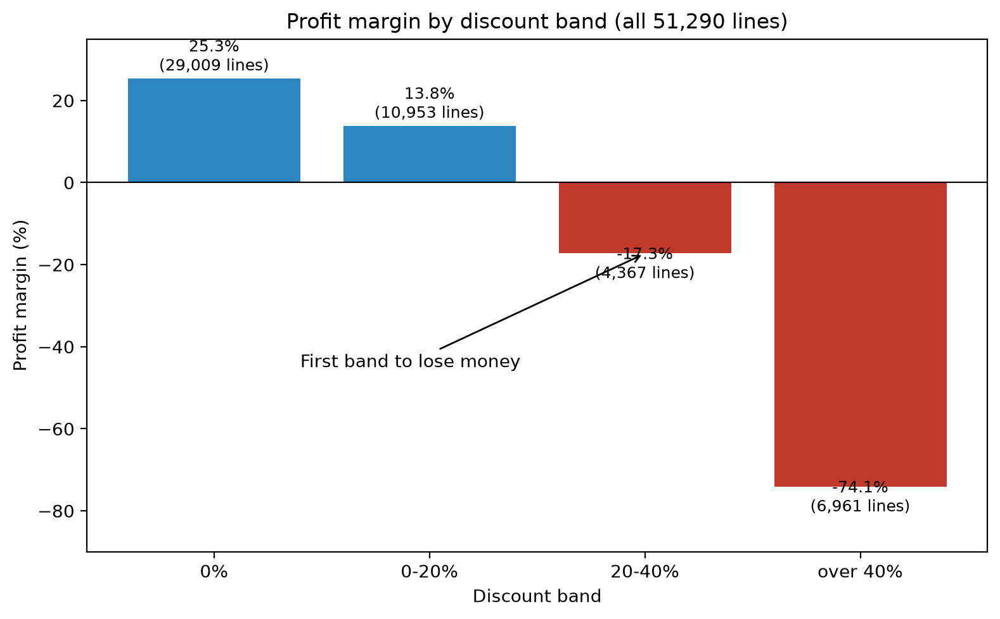
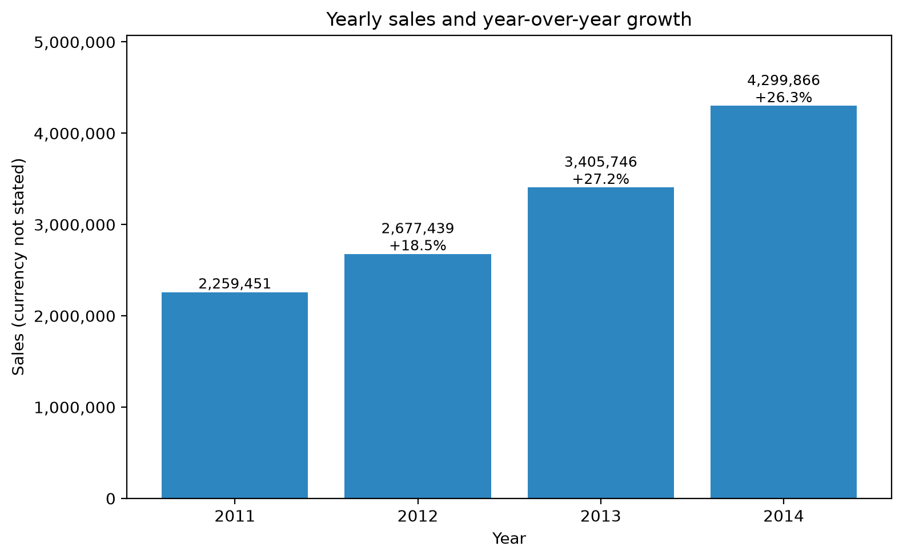

# Sales Data Analysis: Superstore Orders (2011-2014)

Jupyter notebook analysis of 51,290 order lines: revenue, profit, trends, product lines, geography and the effect of discounting. Built for the CodeNova Internship, Data Science track, Task 1.

## Key results

| Metric | Value |
|---|---|
| Total sales | 12,642,501.91 (currency not stated in the data) |
| Total profit | 1,469,034.82 |
| Profit margin | 11.62% |
| Units sold | 178,312 |
| Orders | 25,035 |
| Average order value | 504.99 |

Yearly sales: 2,259,451 (2011), 2,677,439 (2012, +18.5%), 3,405,746 (2013, +27.2%), 4,299,866 (2014, +26.3%).

## Executive summary

- **Growth is strong but slowing slightly.** Sales grew every year; growth was +27.2% in 2013 and +26.3% in 2014.
- **Sales are seasonal.** September to December make up 45.4% of all sales, while January and February together make up 9.6%. December is the peak month in 2011, 2012 and 2013; in 2014 the peak was November (555,279).
- **Technology and Office Supplies earn about twice Furniture's margin.** Margins are 13.99%, 13.69% and 6.98%.
- **Top sellers and profit leaders differ.** Phones sell the most (1,706,824) at a 12.70% margin. Copiers earn the most profit (258,568, margin 17.13%). Paper has the highest margin (24.24%) on small sales.
- **Tables are the only loss-making sub-category:** profit -64,083 on 757,042 of sales. Tables are discounted about twice as heavily as other lines (average 29.1% vs 14.0%), and profit turns negative above 20% discount.
- **Discounting above 20% is associated with losses across the whole dataset.** Margin is 25.32% at 0% discount and 13.79% at 0-20%, but -17.28% at 20-40% and -74.13% above 40%. The 11,328 lines discounted above 20% (22% of lines, about 15% of sales) lost a combined 814,682.
- **Geography:** APAC, EU and the US are the largest markets. EMEA has the lowest margin (5.45%) and the heaviest discounting (32% of lines above 20%). Indonesia has a 3.86% margin with 59% of lines discounted above 20%.

## Recommendations

1. **Review discounts above 20% first.** These lines lose money in aggregate. Set approval rules for deep discounts and track margin by discount band. We cannot say how much profit would be recovered, because buyers at a discount might not have bought at full price.
2. **Reprice or restructure Tables.** Profit is positive up to 20% discount and negative above it. Cap Tables discounts and re-check.
3. **Investigate EMEA and Indonesia.** Both combine heavy discounting with low margins. Check shipping cost and product mix as well before changing prices.
4. **Plan stock and campaigns around September to December,** and avoid deep discounts in the months that already sell well.
5. **Protect and promote the high-margin lines** (Copiers, Accessories, Paper, Labels), which hold their profitability.

## Charts








## Method and checks

- `aov = total sales / unique order_id` (orders have several lines).
- Every grouping (month, quarter, year, category, sub-category, market, region, country, segment, ship mode) is asserted to sum to the grand totals for sales, profit and units; see `reports/reconciliation.csv`.
- Margin = profit / sales. Discount bands: 0%, 0-20%, 20-40%, over 40%.

## Limitations

- Discount findings show association, not causation. Shipping cost, product mix and customer type were not controlled for.
- The data does not say why discounts were given, or what would have sold without them.
- Seasonality comes from four years of data; one year's peak can differ from the combined pattern.
- Not every gap is explained by discounts (for example Brazil's 8.33% margin with a 0.15 average discount).
- Canada's high margin (26.62%) rests on a very small sales base (66,928).
- The currency is not stated, so no currency symbol is used.
- Country and market margins compare totals only; no significance testing was done.

## Tech stack
Python, pandas, NumPy, Matplotlib, Seaborn, Jupyter (VS Code).

## Project structure
```
codenova-ds-sales-analysis/
├── notebooks/01_sales_analysis.ipynb
├── charts/            (6 PNG charts, 200 dpi)
├── reports/reconciliation.csv
├── data/raw/          (put superstore_sales.xlsx here; not committed)
├── requirements.txt
├── .gitignore
└── README.md
```

## Setup and usage
1. Download the dataset (link below) and save it as `data/raw/superstore_sales.xlsx` (sheet `Orders`).
2. `python -m venv .venv`, activate it, then `pip install -r requirements.txt`.
3. Open `notebooks/01_sales_analysis.ipynb` and Run All.

## Data source and license
- Dataset: [Superstore Sales Dataset on Kaggle], [author], [[Kaggle URL](https://www.kaggle.com/datasets/amirmotefaker/superstore-sales-dataset)], license **CDLA-Sharing-1.0** (https://cdla.dev/sharing-1-0/).
- Changes made: none to the source file. Only the `Orders` sheet is used, and the results are aggregates.
- The raw data is not included in this repo.

## Author
Clement Yaw Amegashie, [github.com/Acykhin247](https://github.com/Acykhin247)